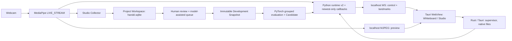

# Hand-D v2 — entrega técnica al siguiente contribuidor

**Tipo:** Referencia / handoff

**Corte de información:** 2026-10-11

**Estado:** desarrollo activo; no equivale a lanzamiento de producto

**Rama de trabajo:** `feature/hand-d-v2-modernization`

**Último commit funcional auditado antes de este handoff:** `08e0013` (`HD-10Q`)
**Para empezar inmediatamente:** [instalación v2](../runbook/setup-v2.md) → [tickets](../changes/hand-d-v2-tickets.md) → [runbook detallado](../runbook/development.md).

> La documentación está en español para el equipo. **La interfaz completa de Whiteboard y Studio debe permanecer en inglés** (ADR 0005). Lee [`AGENTS.md`](../../AGENTS.md) antes de modificar código.

## 1. ¿Qué es Hand-D y hacia dónde vamos?

**Hand-D Whiteboard** es un lienzo de dibujo controlado con gestos y mouse, con cámara opcional, tinta editable, borrador transparente y un pincel Wiggly. **Hand-D Studio** es su área avanzada para abrir/producir un Project Workspace, recolectar landmarks de manos, revisar calidad, preparar datasets versionados, generar Snapshots, activar modelos y consultar el runtime.

El objetivo del tramo v2 no es embellecer la antigua aplicación Tkinter: es tener un camino **auditable y reproducible** desde una observación humana real hasta un Candidate de PyTorch usable por un Whiteboard de escritorio. Queremos:
- evitar bugs de handedness, modelos incompatibles, contaminación de train/test y etiquetas incorrectas;
- no guardar fotos ni video en el dataset;
- separar las decisiones de un humano de las sugerencias de un modelo;
- poder usar CPU y conservar la tinta aunque la cámara o el sidecar fallen;
- mejorar **UX** para que capturar y revisar datos no requiera aprobar manualmente miles de observaciones.

**No está demostrado todavía:** precisión del clasificador v2 con una cohorte humana independiente, test sellado P003, latencia completa sensor→pantalla medida, experiencia final de Studio validada en Tauri con operador, ni instalación macOS/Windows probada físicamente.

## 2. ¿Qué partes existen y cómo se comunican?

| Parte | Archivos clave | Responsabilidad / motivo |
|---|---|---|
| Shell desktop | `desktop/src-tauri/src/main.rs`, `native_files.rs` | Tauri 2, selector de carpetas/archivos, sidecar lanzado/reiniciado y fallos explícitos. No mete video en Rust IPC. |
| Frontend | `desktop/web/index.html`, `app.js`, `style.css` | Whiteboard y Studio en inglés; render SVG, gestos estables y navegación UX. |
| Dibujo | `desktop/web/stroke-renderer.mjs`, `line-boil.mjs`, `hand-overlay.mjs` | Tinta editable, masks para borrar **solo tinta**, Wiggly de tres frames, overlay de 21 puntos. |
| Runtime/IPC | `handd_core/sidecar_main.py`, `sidecar_ipc.py`, `runtime_v2.py` | MediaPipe, clasificación, stream MJPEG, WS autenticado `127.0.0.1` y health/reconexión. |
| Normalización | `handd_core/feature_transform.py` | **Contrato único** 21×3 → float32[69], versión `world-landmarks-v1-69`. Centra en muñeca, corrige espejo de MediaPipe, escala palma y alinea ejes. No duplicarlo en frontend. |
| Recolección | `handd_core/studio_collection.py`, `capture_sampling.py` | Captura del mismo MediaPipe que Whiteboard; omite observaciones inválidas y conserva quota/provenance sin video. |
| Dataset/Review | `handd_core/dataset_store.py`, `studio_workspace.py`, `review_assessment.py` | SQLite canónico, audit trail y revisión asistida; decisiones humanas vs puntuaciones de modelo. |
| Snapshots | `handd_core/snapshot_builder.py`, `snapshot_readiness.py` | Congelar **accepted + active** de P001/P002 en `manifest.json` / `dataset.npz`; excluir P003. |
| Training/modelos | `handd_core/model_training.py`, `model_artifact.py`, `studio_models.py`, `train_cli.py` | PyTorch baseline, validación agrupada por Session, OOF, final refit, Candidate verificable con hashes y activación explícita. |
| Legacy | `visualizer_app/`, `dataset_extraction_tools/`, `model_training/gesture_classifier.py` | Contexto y comparación histórica; **no** es el código principal del escritorio v2. |

**Datos y privacidad:** el Project Workspace es una carpeta seleccionada por el usuario **fuera del bundle**: `handd.sqlite` + Snapshots + Candidates + reports/assessments. `Review Status` (`unreviewed / accepted / rejected`) y `Lifecycle Status` (`active / dropped`) son independientes. `Dropped` es soft-delete reversible mediante `Restore`, **no** significa un frame viejo omitido por MediaPipe.

**Regla de UI:** los 69 features canónicos sirven al modelo. La **vista** canónica de Review invierte solamente el eje Y de pantalla (SVG) para mostrar **muñeca/joint 0 abajo**. Ni esta corrección ni la rotación X/Y deben reescribir los features o landmarks originales.

## 3. Qué se implementó, cómo y para qué

| Tickets | Estado hasta este corte | Cómo se abordó / por qué |
|---|---|---|
| **HD-01 / HD-02** | DONE | `uv` + lockfile para reproducibilidad; extracción de Feature Transform v1 validada con fixtures legacy. Evita divergencias entre entrenamiento/runtime. |
| **HD-03 a HD-06L** | DONE (contratos core/CLI) | SQLite con Review/Lifecycle auditados, importación separada de CSV legacy, Snapshot immutable con SHA256 y P003 excluido. No inventar información cruda a partir de features históricos. |
| **HD-07 / HD-08** | DONE (desarrollo CPU) | PyTorch + validación por Collection Session sin mezclar train/validation; OOF + final-refit Candidate; runtime LIVE_STREAM newest-only. Evita fuga de entrenamiento y acumulación de frames obsoletos. |
| **HD-09 / HD-09R** | DONE en alcance Linux comprobado | Desktop Tauri, cámara-first, MJPEG separado de WS, supervisor Rust con READY timeout/retry, selector nativo, Save/Open editable y SVG, reinicio manteniendo tinta; Mac físico pendiente. |
| **HD-10UX** | DONE a nivel código/test; uso humano pendiente | Collect muestra cámara/21 puntos; Review permite 2D + 3D, páginas de Browse y gating de geometría válida. |
| **HD-10CUR** | DONE en código/contratos (2026-10-12); uso humano pendiente en HD-10 | Review asistido integra predicciones OOF verificadas **por sesión excluida** para las muestras históricas y el Candidate final para nuevas muestras fuera de entrenamiento. Alertas históricas previamente aceptadas pueden rechazarse o confirmarse de nuevo mediante un evento auditable; QC aleatorio y batch Accept siguen siendo decisiones humanas. Visor canónico X/Y y workspace simplificado. La aceptación física de Studio sigue pendiente. |
| **HD-10Q** | DONE en código/test; hardware pendiente | Vista 3D muñeca abajo corrigiendo proyección SVG (no transform), filtro de manos parcialmente fuera de cámara, contadores visibles de omisiones. Buscamos calidad sin acumular frames ni descartar datos válidos arbitrariamente. |
| **HD-10 principal** | IN PROGRESS | El tracer sintético completo funciona: Studio → SQLite → Review → Snapshot → CLI train → Candidate → WS/runtime → reinicio del sidecar. **No** equivale a dataset humano verificado ni accuracy real. |
| **HD-11** | TODO (modal parcialmente existente, falta acceptance completa) | Verificar modal ampliado accesible en Whiteboard, close/Escape, strokes conservados. |
| **HD-12** | TODO / opcional | Benchmark PyTorch/ONNX/aceleración solo si existe evidencia de mejora; CPU es la línea base. |

La fuente viva de estado son los [tickets](../changes/hand-d-v2-tickets.md); esta tabla es una fotografía del 11 de octubre.

### Cómo se ha implementado y cómo continuar el trabajo

El desarrollo se ha hecho por **tickets verificables** y cortes pequeños, evitando reconstruir todo el producto de una vez:

1. Partimos de los requisitos de `docs/requirements/` y del flujo demostrable de `docs/spec/hand-d-v2-oct13-tracer.md`; así no declaramos un componente «terminado» solo porque dibuja una UI.
2. En la mayoría de cambios funcionales aplicamos **TDD**: test que reproduce el fallo, código mínimo, ejecución del test y regresión general. Python usa `tests/test_*.py`, JavaScript `desktop/tests/*.test.mjs` y Rust `cargo test`. Ejemplos: regresión de handedness/Feature Transform, eraser sobre cámara, flujo SQLite→Snapshot→Candidate y muñeca abajo.
3. Dividimos responsabilidades: Python procesa MediaPipe/feature/modelo/SQLite; Rust supervisa el proceso y opera archivos nativos; JavaScript presenta cámara y dibujo, sin duplicar el predictor. Esto facilita detectar qué parte falló.
4. Documentamos resultados con **comando y evidencia**, y distinguimos tests sintéticos de pruebas con webcam y validación humana. El proyecto usa `docs/changes/` para trabajo/decisiones pendientes y `docs/runbook/development.md` para pruebas cronológicas.
5. La modernización vive en `feature/hand-d-v2-modernization` con commits pequeños; no se reescribió `main`, ni se borró el código legacy. Cada cambio nuevo debería incluir su prueba y un diff revisado antes de merge.

**Ejemplo de ciclo para un bug:** identificar la interfaz pública donde se observa (p. ej., Sample Captured → SQLite o Review 3D → SVG), añadir prueba fallida para el caso concreto, corregir sin modificar contratos adyacentes, ejecutar suite focalizada y general, actualizar runbook/ticket, documentar límites físicos y abrir PR. No convertir un test de cámara sintética en evidencia de gesto humano correctamente etiquetado.

### Decisiones de producto aprobadas que **no** conviene revertir casualmente

1. **Review asistido, no aceptación silenciosa.** El modelo ordena observaciones por desacuerdo/incertidumbre; el operador revisa las dudosas, hace QC aleatorio y confirma el lote pendiente con un clic. La primera captura, sin Candidate fiable, requiere QC inicial. Un Sample rechazado en QC bloquea batch Accept. **Fuente:** `handd_core/studio_workspace.py:81-180`, `handd_core/review_assessment.py`, `docs/requirements/hand-d-v2.md`.
2. **No evaluar el modelo final-refit contra sus propias muestras de entrenamiento como si fueran nuevas.** Para las históricas, integrar únicamente predicciones held-out/OOF verificables. **Fuente:** `handd_core/review_assessment.py`, `handd_core/model_training.py`.
3. **La muñeca debe verse abajo en la vista canónica**, pudiendo girar la mano en X e Y como en la app legacy. Esto es una regla de representación en pantalla; la transformación canónica compartida no se altera. **Fuente:** `desktop/web/world-landmarks.mjs`, `handd_core/feature_transform.py`, `desktop/tests/world-landmarks.test.mjs`.
4. **Borrador no borra cámara ni botones**, solo tinta mediante máscara SVG transparente; Wiggly usa tres variantes de línea y preserva el path editable original. **Fuente:** `desktop/web/stroke-renderer.mjs`, `line-boil.mjs`, tests frontend.
5. **Inglés en absolutamente toda la UI**; español permitido en documentación técnica. **Fuente:** [ADR 0005](../adr/0005-english-only-product-ui.md).
6. **No grabar imagen/video para entrenar o revisar**. Solo landmarks en SQLite con etiqueta/procedencia y eventos. Ninguna sugerencia de IA sustituye el label humano durante la recolección.
7. **Separar runtime/backend/frontend, CPU fallback y manejo explícito de fallos**. Si cae el sidecar, el Whiteboard sigue mostrando y conservando su documento.

## 4. Qué podemos afirmar y qué falta probar

**Evidencia disponible en el repo:**
- Último corte ejecutado en Linux (2026-10-09, commit `08e0013`): **138 Python, 45 JavaScript y 7 Rust** pasando, junto a `uv lock --check` y `git diff --check`. Fuente: `docs/runbook/development.md`, sección **HD-10Q**.
- Cámara física/Linux y sidecar empaquetado tuvieron pruebas anteriores documentadas (imagen preview y algunos Samples reales de diagnóstico). **No** demostraron calidad de etiquetas ni accuracy de modelo entrenado; fuentes: runbook de desarrollo y HD-09.
- El tracer `tests/test_hd10_tracer.py` crea datos **sintéticos** y prueba integración contractual real; no produce un resultado válido para comparar precisión humana.
- Versiones/bibliotecas están bloqueadas en `uv.lock`, `desktop/package-lock.json`, `desktop/src-tauri/Cargo.lock`.

**Pendientes imprescindibles para aceptar HD-10:**
- Validación humana del Studio real (Collect y Review) y de su ergonomía en Tauri, en Linux con cámara y luego en macOS.
- Comprobar que la mano física se asigna correctamente a Drawing/Modifier en cada cámara y que no se rechazan demasiadas manos legítimas por el filtro de encuadre.
- Recolectar gestos humanos correctamente etiquetados, revisar QC, construir Snapshot nuevo, entrenar Candidate, activar y comprobar gestos/Whiteboard con trazabilidad y **métricas honestas**.
- Medir callback→WS→Whiteboard/WebKit; los p95 internos de Python/loopback no son esa métrica.
- Integrar OOF histórico del entrenamiento al sistema de Model Assessments; su ausencia es deuda real, no algo que deba inventarse por UX.
- Validación Mac Apple Silicon y permisos de webcam + child empaquetado; Windows nativo sin evidencia de soporte.
- P003 Final Test sellado cuando haya protocolo/datos apropiados; no mirar P003 durante selección de hiperparámetros.
- CI automatizada de varias plataformas, backups/recovery antes de migraciones SQLite futuras potencialmente destructivas.

**Prioridad recomendada para un nuevo contribuidor:** estabilizar la experiencia humana **antes** de pedir 120 muestras × 5 gestos × 2 participantes. Hacer primero un **piloto de 10–20 observaciones** con un workspace temporal, revisar si Studio reporta omisiones con sentido, comprobar muñeca abajo, QC/batch y luego volver a HD-10 completo. No modificar pesos ni umbrales del clasificador por intuición.

## 5. Primeros 45 minutos de onboarding

1. Leer [instalación](../runbook/setup-v2.md) y seguir el setup en la rama correcta.
2. Ejecutar tests sin cámara y arrancar `npm --prefix desktop run dev`.
3. Explorar Whiteboard (video opcional, Pen, Eraser, Wiggly, Undo/Redo). Verificar que borrar no tapa video/controles.
4. Abrir Studio y seleccionar **Create workspace…** apuntando a una carpeta temporal **vacía**, nunca al repo ni al workspace de otro contribuidor.
5. Con la cámara funcionando, Collect → gesto/hand P001 → 10–20 Samples → **Review this Capture**. Confirmar que la vista canónica muestra muñeca abajo, se puede girar X/Y y el contador de tracking omite manos fuera de encuadre.
6. Examinar Browse/Review: `unreviewed`, QC aleatoria y decisión batch explícita. Sin Candidate, **no** esperar sugerencias ML.
7. Leer los [tickets](../changes/hand-d-v2-tickets.md) y acordar un issue limitado con tests. Trabajar en rama hija, revisar el diff, enviar PR, nunca fusionar a `main` sin revisión.

**Evitar el primer día:** ejecutar train CLI contra el workspace ajeno; aceptar todos los Samples sin evidencia; inventar accuracy de P003; sobreescribir `handd.sqlite`; abrir dos colecciones sobre la misma cámara; borrar o renombrar recursos legacy sin verificar referencias; cambiar el Feature Transform sin migración/contracto.

## 6. Dónde continuar leyendo

- [Instalación desde cero — Linux / Mac / límites Windows](../runbook/setup-v2.md)
- [Requisitos y criterios de producto](../requirements/hand-d-v2.md)
- [Tickets verificables y estado](../changes/hand-d-v2-tickets.md)
- [Especificación del tracer HD-10](../spec/hand-d-v2-oct13-tracer.md)
- [Diseño UX aprobado](../design/hand-d-v2-ux-shape.md)
- [Runbook de desarrollo: evidencia histórica y comandos](../runbook/development.md)
- [Check de macOS y permisos](../runbook/mac-lab-oct09.md)
- [ADRs](../adr/) y [glosario](../../CONTEXT.md)
- [Guía de colaboración/AGENTS](../../AGENTS.md)

**Limitación de este documento:** Describe el código y las pruebas del corte indicado; algunas referencias arquitectónicas previas todavía contienen secciones históricas como si fuesen estado actual. Ante contradicción, **confirma el comportamiento leyendo el código y el ticket correspondiente**. No hay una validación física nueva de cámara/macOS asociada a este handoff.
